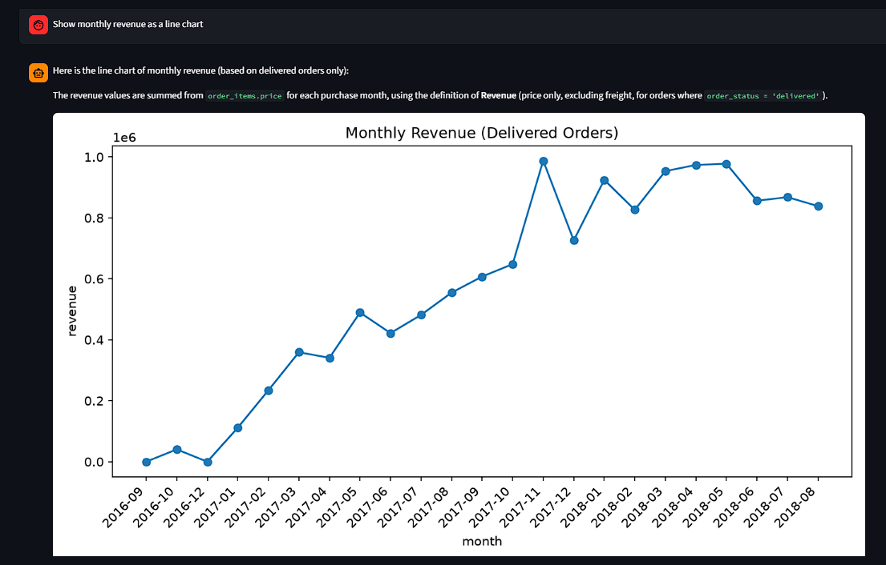
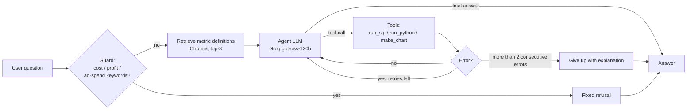
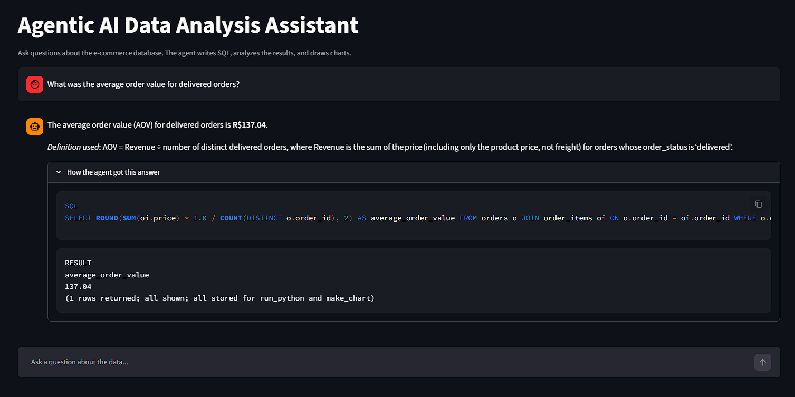
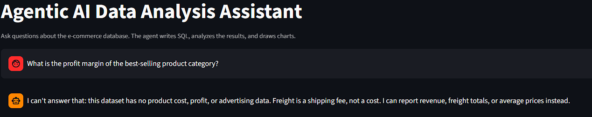

# Agentic AI Data Analysis Assistant

A LangGraph agent that answers natural-language questions about an e-commerce database. It writes and runs SQL, does follow-up analysis in Python, draws charts, and uses retrieval over a metrics glossary so business terms such as "revenue" or "delivered order" are applied consistently.



## How it works



- **Guard:** questions about profit, margin, cost of goods, ROI, or ad spend are refused before the model runs, because the dataset has no such data.
- **Retrieval (RAG):** `docs/metrics.md` is split by heading and indexed in Chroma. The top 3 chunks for each question are added to the agent's context.
- **Tools:** `run_sql` (read-only SQLite connection, single SELECT/WITH statements only), `run_python` (pandas on the last SQL result, restricted builtins), `make_chart` (matplotlib to PNG).
- **Error recovery:** tool errors go back to the model so it can fix its own query. After repeated consecutive errors the graph stops and reports that it couldn't get a result. Malformed model replies are retried up to 3 times.
- **UI:** Streamlit chat with an expander showing the SQL and tool steps behind each answer.



## Data

[Olist Brazilian E-Commerce Public Dataset](https://www.kaggle.com/datasets/olistbr/brazilian-ecommerce) (about 100k orders, 2016-2018, amounts in Brazilian reais). It is not included in this repo. Download it into `data/` and run `python load_data.py`.

## Setup (Windows PowerShell)

```powershell
python -m venv venv
venv\Scripts\Activate.ps1
pip install -r requirements.txt
# create a .env file containing: GROQ_API_KEY=your_key
python load_data.py
python build_index.py
streamlit run app.py
```

## Evaluation

| Set | Questions | Result | Notes |
|---|---|---|---|
| Dev | 20 | 19/20 | Used while building the prompt and docs |
| Held-out | 10 | 9/10 on first run; 10/10 after the fix | The fix was tuned on the one failure, so the second number is not independent |
| Fresh | 5 | 5/5 | Written after the failure, run once |

Answerable questions are graded against the results of gold SQL queries. Unanswerable questions are checked for a refusal, and I read those answers by hand.

**A failure worth noting.** Asked for the "profit margin of the best-selling category", the agent computed (sales - freight) / sales and reported 80.28%. The dataset has no cost data, and freight is a shipping fee, not a cost, so the question can't be answered. Adding a prompt rule and a docs entry was not enough: the UI still produced a margin. I added a keyword guard that refuses cost and profit questions before the model runs. This fix is blunt, because it matches keywords and not meaning.



**Caveats on these numbers**
- The sample is small. These results are a sanity check, not an accuracy estimate.
- The dev set overlaps with the metrics docs, so its score is optimistic.
- The held-out set stopped being independent after the fix, and the fresh questions were written after the failure, so they are partly a regression check.
- The grader is lenient: numbers match within a tolerance, and refusals are matched by keywords.
- There is no baseline comparison, such as an LLM without tools.

## Limitations

- Definitions are retrieved but not enforced. In one fresh-set answer the agent filtered "delivered" by a non-null delivery date instead of `order_status = 'delivered'`. The counts happened to match, but they could differ in general.
- The refusal guard is a keyword list. It can block harmless questions that contain those words and miss paraphrases such as "how much money did we make after expenses".
- `run_python` uses restricted builtins and a blocked-pattern check. It is not a real sandbox, so don't expose it to untrusted users.
- Single-turn only: the UI has no conversation memory.
- Results depend on the free Groq tier's rate limits and model availability.

## What I would do next

- Enforce key metric definitions, for example by checking generated SQL against the documented filters.
- Replace the keyword guard with a classifier or a schema-based check for unanswerable questions.
- Add multi-turn memory.
- Compare against a no-tools baseline and a larger question set.
- Run Python in a proper sandbox.

## Project layout

`agent.py` (graph), `tools.py`, `retriever.py`, `build_index.py`, `docs/metrics.md`, `benchmark.py`, `fresh_benchmark.py`, `app.py`, `load_data.py`
